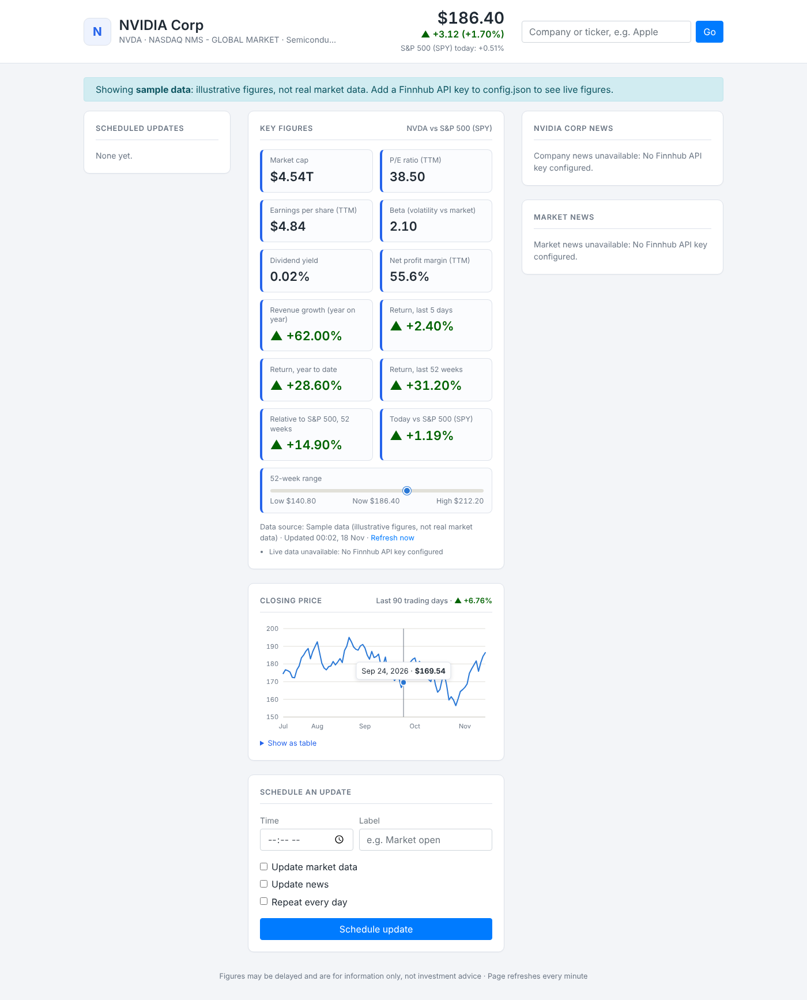

# Company Financial Dashboard

A Flask dashboard that shows key figures, a price chart and news for any listed company. Type a company name or ticker (for example *NVIDIA* or *NVDA*) and the whole page switches to that company: its price and day change, valuation and return figures, how it compares with the S&P 500, a 90-day price chart, a few recent stories about it and general market headlines. You can schedule automatic data and news refreshes for a time of day, either once or daily.

It's a rebuild of my [Personalised COVID-19 Dashboard](https://github.com/fadhill-taariq/Covid-19-Personalised-Dashboard), with a company in place of the local area and a market benchmark in place of the nation. The main addition is a modular provider layer: every data source sits behind the same small interface, so sources can be swapped in `config.json` without touching the rest of the app.



*The screenshot shows the bundled sample data (illustrative figures, not real market data), which is what you see before adding API keys.*

## Features

- **Any company:** search by name or ticker. If a name matches several companies, the dashboard lists them to choose from.
- **Key figures:** price and day change, market cap, P/E, EPS, beta, dividend yield, net margin, revenue growth, 5-day / year-to-date / 52-week returns, performance relative to the S&P 500 and the 52-week range.
- **Benchmark comparison:** the company's move today against the S&P 500 (SPY, configurable).
- **Price chart:** 90 trading days of closing prices, with a hover readout and a table view. Drawn as plain SVG, so no charting library is needed.
- **Two news feeds:** stories about the selected company, and general financial news. Dismissed articles stay hidden after later refreshes.
- **Scheduled updates:** pick a time and a label, and choose whether to refresh market data, news, or both, once or every day.
- **Works without keys:** if live data can't be fetched, the dashboard falls back to bundled sample data for NVIDIA and labels it clearly as illustrative.
- **Gentle on free tiers:** answers are cached for 10 minutes (configurable), and data is only fetched at startup, when you switch company, refresh or a scheduled update runs, not on every page load.

## Data providers

| Provider | Used for (default config) | Free tier |
| --- | --- | --- |
| [Finnhub](https://finnhub.io) | Profile, quote, key metrics, company and market news, symbol search | About 60 requests a minute, US-listed companies |
| [Alpha Vantage](https://www.alphavantage.co) | Price chart (Finnhub's price history is a paid endpoint) | 25 requests a day |
| [NewsAPI](https://newsapi.org) | Optional alternative news source | 100 requests a day, development use |
| Sample data | Offline fallback and tests | Bundled (NVDA, SPY) |

Each role can use any provider that supports it. For example, to take company news from NewsAPI instead:

```json
"providers": {
    "market_data": "finnhub",
    "price_history": "alpha_vantage",
    "company_news": "newsapi",
    "market_news": "finnhub"
}
```

Alpha Vantage can also act as the `market_data` provider, but with 25 requests a day it runs out quickly. Free tiers change, so check each provider's current limits.

## Project structure

| File | Purpose |
| --- | --- |
| `app.py` | Flask app and routes (entry point) |
| `company_data_handler.py` | Gathers a company's profile, quote, metrics, chart and benchmark; falls back to sample data |
| `news_handling.py` | Company and market headlines, and the dismissed list |
| `update_scheduler.py` | Schedules, repeats and cancels updates using Python's `sched` module |
| `formatting.py` | Number formatting and chart geometry for the template |
| `config.py` | Loads settings from `config.json` and environment variables |
| `providers/base.py` | The provider interface, shared parsing helpers and the cache |
| `providers/finnhub.py`, `alpha_vantage.py`, `newsapi.py`, `sample.py` | One module per data source |
| `providers/__init__.py` | Registry that builds providers from config |
| `templates/index.html` | Dashboard page |
| `data/sample/` | Illustrative sample data for offline use and tests |
| `tests/` | pytest suite |

## Getting started

Requires Python 3.9 or later.

```bash
git clone https://github.com/fadhill-taariq/Company-Financial-Dashboard.git
cd Company-Financial-Dashboard
python -m venv venv
source venv/bin/activate        # Windows: venv\Scripts\activate
pip install -r requirements.txt
```

### Configuration

Copy the example config and edit it:

```bash
cp config.example.json config.json
```

| Setting | Meaning |
| --- | --- |
| `default_symbol` | Company shown at startup, e.g. `NVDA` |
| `benchmark_symbol` / `benchmark_name` | What the company is compared against, e.g. `SPY` / `S&P 500 (SPY)` |
| `providers` | Which provider to use for each role (see above) |
| `api_keys` | Free keys from [Finnhub](https://finnhub.io/register), [Alpha Vantage](https://www.alphavantage.co/support/#api-key) and, optionally, [NewsAPI](https://newsapi.org/register) |
| `company_news_count` / `market_news_count` | How many stories each news panel shows |
| `cache_minutes` | How long provider answers are reused |

`config.json` is git-ignored so your keys are never committed. You can also set keys as environment variables instead:

```bash
export FINNHUB_API_KEY=your-key
export ALPHA_VANTAGE_API_KEY=your-key
export NEWS_API_KEY=your-key
```

With no keys at all the dashboard still runs, showing the NVIDIA sample data.

### Running

```bash
python app.py
```

Then open <http://127.0.0.1:5000/index>. The page refreshes every minute, which is also when due scheduled updates run. Scheduled updates and dismissed articles are held in memory, so they are lost when the app stops.

### Tests

```bash
pytest
```

The tests don't need network access or API keys: providers are given fake HTTP sessions, and the scheduler runs on a simulated clock.

## Adding a data provider

1. Create `providers/yourprovider.py` with a class that subclasses `providers.base.Provider`.
2. Implement whichever methods the API supports (`get_profile`, `get_quote`, `get_metrics`, `get_price_history`, `get_company_news`, `get_market_news`, `search_symbols`), returning the standard shapes described at the top of `providers/base.py`. Raise `ProviderError` when data can't be fetched; methods you don't implement raise `NotSupported` automatically.
3. Add the class to `REGISTRY` in `providers/__init__.py`.
4. Name it against a role in `config.json`.

## Notes

Figures from free tiers may be delayed. This project is for learning and information only, not investment advice. Styling uses [Bootstrap 4](https://getbootstrap.com) (MIT licence), bundled in `static/css`. Market data and news belong to their respective providers; check each provider's terms before using the data beyond personal projects.
